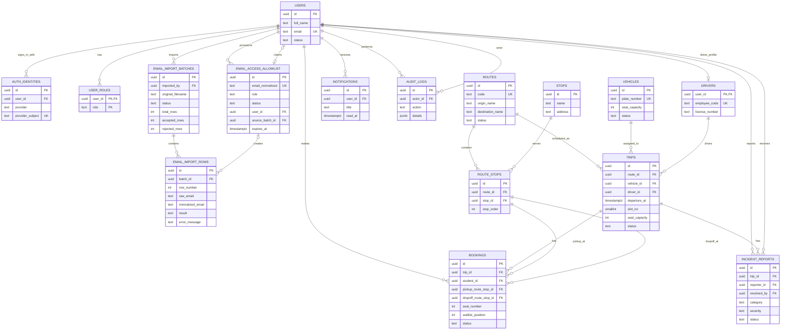

# SeatChain database design

## Scope

This design covers the current student mobile app, driver screens, and admin web app. It uses PostgreSQL and stores the two route directions as separate route records:

- `FU HCM → FU Tân Uyên`
- `FU Tân Uyên → FU HCM`

Stops, vehicles, drivers, trips, and users are shared across all clients. Admin is a role on a user account, not a second database. The demo screens currently use local sample data; this schema is the proposed backend foundation.

## ER diagram



## Main rules

1. **Identity and access:** `users` is the common account. `auth_identities` maps Google or FEID provider subjects to the account. `user_roles` grants `student`, `driver`, or `admin`; never trust a role supplied by the mobile/web client without checking it on the server.
2. **Routes and stops:** each travel direction is a separate `routes` record. `route_stops.stop_order` defines its stop sequence. The starter route includes FU HCM, an editable transfer stop, and FU Tân Uyên; confirm actual stop names and addresses before production.
3. **Trips:** one `trips` row is one scheduled departure. `slot_no` supports the app's 1–6 slot filter. `seat_capacity` snapshots the trip's available capacity so a vehicle replacement or later vehicle edit does not silently rewrite an already published trip. A manager can explicitly change this value.
4. **Bookings and waitlist:** one booking links a student, trip, pickup stop, and drop-off stop. `waitlisted` bookings have no seat number. Only booked/boarded records consume a seat; cancellation and no-show release it. A student may have only one active booking/waitlist entry for a trip.
5. **Capacity safety:** booking must run in a database transaction: lock the trip row (`SELECT ... FOR UPDATE`), count booked/boarded bookings, compare with `seat_capacity`, then insert a booked or waitlisted booking. When a seat is released, promote the lowest `waitlist_position` in the same transaction and assign that seat. This prevents two users from taking the final seat concurrently.
6. **Pickup/drop-off validation:** a booking must use stops from the trip's route and pickup must come before drop-off. The SQL trigger enforces both constraints.
7. **Reports and notifications:** driver reports belong to a trip and reporter, and can be assigned/resolved by a manager. Notifications are per-recipient with `read_at` for unread state. Send notifications from backend events such as booking, promotion, trip change, and incident resolution.
8. **Admin reporting:** dashboard totals should be calculated from trips, bookings, and incident reports for a selected time window; do not persist demo KPI totals as independent facts.
9. **Excel email allowlist:** an admin uploads a workbook containing email addresses and optionally a `role` column (`student` or `driver`). Omitted roles default to `student`. The backend normalizes emails (trim whitespace and lowercase), validates every row, then writes accepted entries to `email_access_allowlist` and all row outcomes to `email_import_rows`. Never grant `admin` through an imported spreadsheet; provision admin accounts through a separately controlled process.
10. **Login authorization:** after Google/FEID authentication verifies the identity email, the backend must find a matching, active, unexpired allowlist entry before creating/linking a `users` account or issuing a session. The allowlist role is then granted in `user_roles`. An unlisted, revoked, or expired email is denied access even if the identity provider authentication succeeded. Do not rely on a client-side check.
11. **Safe import behavior:** validate file type/size and required columns; reject malformed addresses and duplicate addresses within the workbook; report row number and reason. Imports should not silently reactivate revoked addresses or overwrite an existing user's role. Require an explicit admin action for those changes. Keep the original workbook out of the database; retain filename/checksum and row-level results for audit and support.

## Files

- `schema.sql` is a PostgreSQL baseline schema. Apply it once to a new development database, then evolve it with numbered migrations.

## Suggested implementation order

1. Create route and stop master data, users/roles, vehicles, and driver accounts.
2. Add trips and admin trip-management endpoints.
3. Add transactional booking, cancellation, check-in/no-show, and waitlist promotion.
4. Add notifications and driver incident-report workflows.
5. Add audit entries for admin changes and connect reports/dashboard queries.
6. Add Excel import preview/commit, row-level results, and allowlist enforcement in the Google/FEID callback.

The schema does not include payments, live GPS, or passenger-by-passenger seat allocation across overlapping route segments because those are not part of the current prototype requirements.

### Login allowlist check

After verifying the identity-provider token on the server, normalize its verified email and require this query to return an entry before issuing an app session:

```sql
SELECT id, role, user_id
FROM email_access_allowlist
WHERE email_normalized = lower(btrim($1))
  AND status = 'active'
  AND (expires_at IS NULL OR expires_at > now());
```

If the account does not exist yet, create `users`, link `auth_identities`, set `email_access_allowlist.user_id`, and grant the allowlist role in `user_roles` in one transaction. If it already exists, do not replace its profile or roles from an import row; use the allowlist to authorize access and require a separate audited admin action to change roles.
